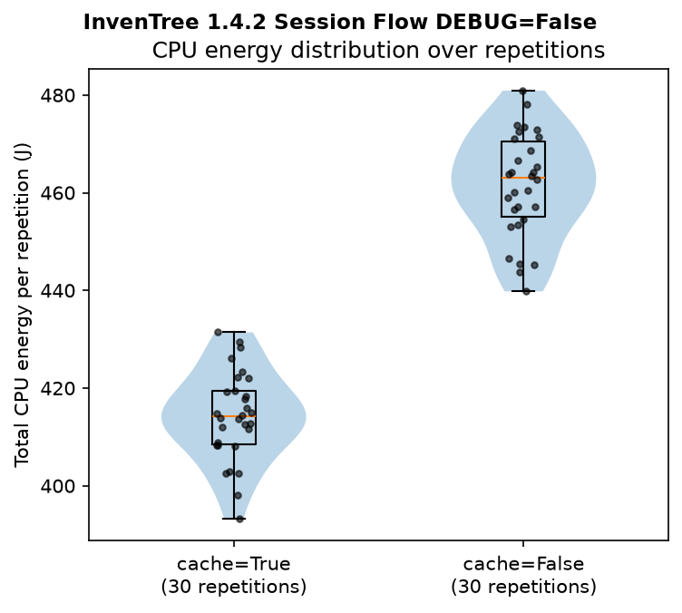
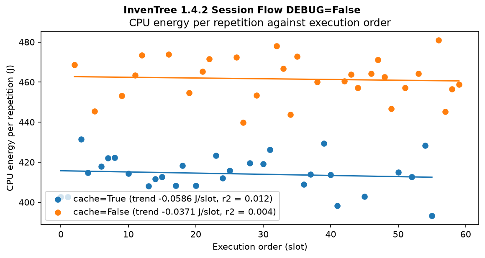
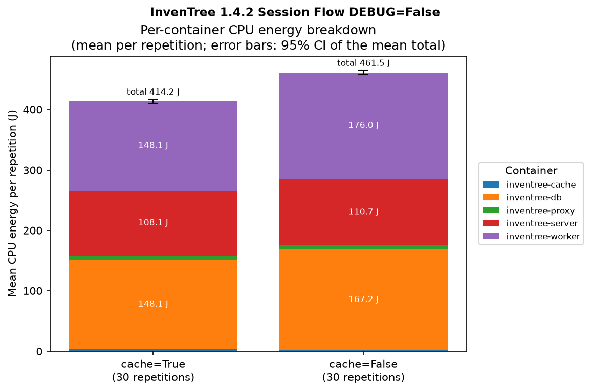
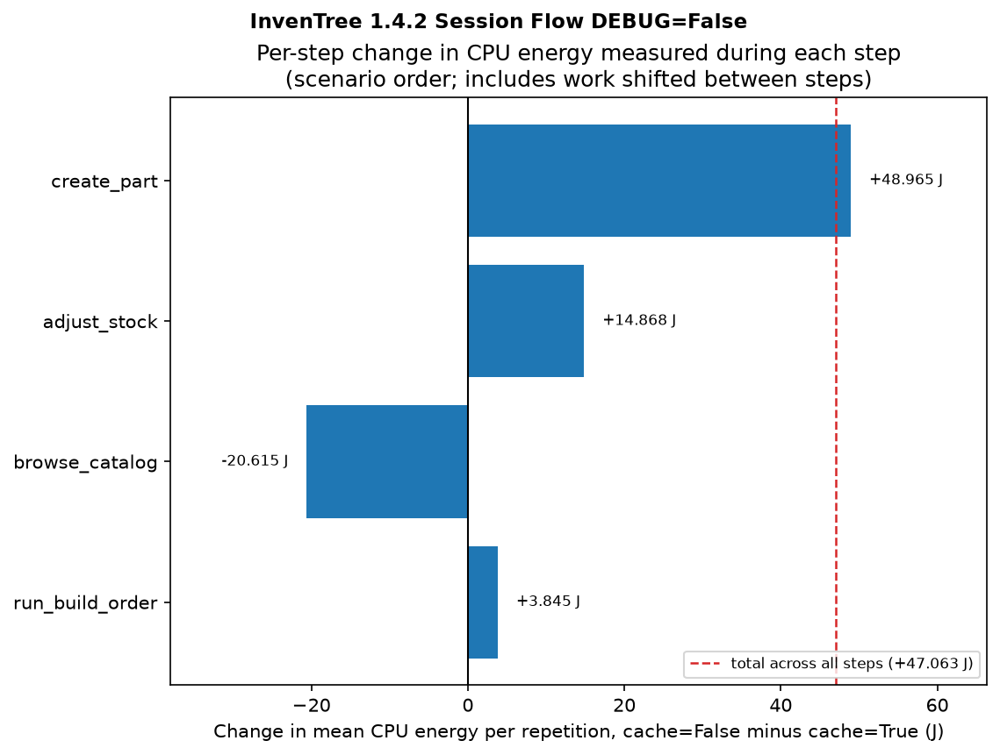

# MetriLens

---

MetriLens measures and compares the energy consumption of two functionally equivalent versions of a
Dockerized application, for example a legacy system and its modernized reimplementation. It drives
both through the same user-level workload, attributes energy to each version's own containers, and
reports the difference with confidence intervals. This repository contains the framework and an example validation on InvenTree, 
an open-source inventory system, where the expected outcome is known in advance.

## Why MetriLens?

---

- Each measurement is tied to a scenario, an application version and a script that has been checked to be
  equivalent across versions, so a measured difference can be attributed to the versions instead of to different workloads.
- The application is exercised through its own web UI with Playwright, so the measurement reflects 
  real user workflows.
- MetriLens uses [METRION](https://github.com/ds-lab/metrion)'s hread-level energy measurements and keeps 
  only the threads of the measured containers, so other processes on the host are excluded from the result.
- Every repetition starts from a freshly reset stack, the two versions run in randomized interleaved order, 
  and idle power is calibrated per session.
- MetriLens produces a detailed report with descriptive statistics, difference metrics with confidence
  intervals and figures, plus a `summary.json` with every repetition.

## Context

---

- **Scenario:** The workload is a version-independent list of steps. Because a legacy application
  and its reimplementation may differ in UI, each version gets its own script, and a pre-flight
  check confirms both produce the same steps and entities before anything is measured.
- **Measurement:** METRION, a thread-level CPU and DRAM energy attribution framework, monitors each
  repetition. MetriLens asks it for the window of the declared steps and keeps the rows that belong
  to the version's containers.
- **Results:** Every repetition is stored with its session, version and scenario in MetriLens's own
  SQLite database, and its raw exports are archived, so a report can be regenerated at any time.

## Example evaluation

---

The repository's validation uses InvenTree with a known outcome: its default configuration
(`DEBUG=False`, `cache=True`) against variants expected to use more energy. Three sessions on one
bare-metal host, 30 repetitions per version each, all against the same baseline:

| Session | Compared version | Difference per repetition | Welch 95% CI | Relative (Fieller 95% CI) |
|---|---|---|---|---|
| `debug_only` | `DEBUG=True cache=True` | +8.9 J | [+3.5, +14.4] J | +2.2% [+0.8, +3.5] |
| `cache_only` | `DEBUG=False cache=False` | +47.3 J | [+42.1, +52.4] J | +11.4% [+10.1, +12.7] |
| `debug_and_cache` | `DEBUG=True cache=False` | +51.3 J | [+46.0, +56.6] J | +12.3% [+11.0, +13.7] |

MetriLens detects both expected effects: disabling the cache costs about 11%, debug mode about 2%,
on a baseline of about 414 J per repetition. The figures below are from the `cache_only` session:

<p align="center">
  
  
</p>
<p align="center">
  
  
</p>

These are the measurements behind the accompanying paper. They live in
[`paper-evaluation/`](paper-evaluation/README.md), one folder per session, each holding the
generated `comparison_report.md`, `summary.json` (including every repetition) and all figures as PNG
and PDF. They show what MetriLens produces for a real comparison and let readers check every number
in the paper. The raw per-repetition archives are not published.

## Getting started

---

MetriLens needs a bare-metal Linux host with an Intel CPU (RAPL), Docker, Python 3.12+ and
[`uv`](https://docs.astral.sh/uv/), plus a root-owned METRION install with passwordless `sudo` for
a few commands. Follow the guides in this order:

| To | Follow |
|---|---|
| install METRION and MetriLens, configure them, deploy the example stacks and load the scenario | [docs/guides/installation.md](docs/guides/installation.md) |
| deploy the InvenTree stacks used in the example | [stacks/inventree/README.md](stacks/inventree/README.md) |
| prepare the machine before each session and clean up after it | [docs/guides/machine-setup.md](docs/guides/machine-setup.md) |
| run a session, retry a repetition and generate the report | [docs/guides/running-a-session.md](docs/guides/running-a-session.md) |
| measure your own application | [docs/guides/adding-a-scenario.md](docs/guides/adding-a-scenario.md) |
| read the published results | [paper-evaluation/README.md](paper-evaluation/README.md) |

Use a dedicated machine and account, and run the smoke test from the installation guide before the
first real session: a session takes hours, and the smoke test finds setup problems in minutes.

## Commands

---

Run from the repository root with `uv run metrilens ...`. `--help` on any command lists all options.

| Command | What it does |
|---|---|
| `scenario load PATH` | Load a scenario definition. |
| `app-version load PATH --scenario-id` | Load a scenario's `app_versions.yaml` (insert-only). |
| `run-session --scenario-id --version-a-id --version-b-id --repetitions` | Run a session: pre-flight check, idle calibration, repetitions. `--version-a-id` is the baseline. |
| `retry --repetition-id` | Retry a repetition that failed after its automatic retries. |
| `report --scenario-id --comparison-session-id` | Write the report, `summary.json` and figures to `evaluation/<host>/<scenario>_<session>/`. |
| `record --scenario-id --version-a-id [--version-b-id]` | Record a video of the scenario; not a measurement. |

## Development

---

`uv sync` installs everything from `uv.lock`. `uv run pytest` runs the test suite, which mocks the
METRION and hardware boundary and needs no real install. `uv run ruff check .` and
`uv run ruff format` lint and format the code (100-character lines).

## Citation

---

If you use MetriLens in your research, please cite it. See: [CITATION.cff](CITATION.cff) (GitHub shows a “Cite this repository” button).

```bibtex
@software{boehm2026metrilens,
  author  = {Böhm, Tobias and Bechthold, Domenic},
  title   = {{MetriLens}: Comparing the Energy Consumption of Functionally Equivalent Application Versions},
  year    = {2026},
  version = {0.1.0},
  url     = {https://github.com/boehmtobias/MetriLens}
}
```

MetriLens uses METRION for energy attribution; please also cite it:

```bibtex
@inproceedings{weigell2026metrion,
  author    = {Weigell, Benjamin and Hornung, Simon and Bauer, Bernhard},
  title     = {{METRION}: A Framework for Accurate Software Energy Measurement},
  booktitle = {Proceedings of the IEEE/ACM 10th International Workshop on Green and Sustainable Software (GREENS '26)},
  pages     = {131--138},
  year      = {2026},
  publisher = {Association for Computing Machinery},
  doi       = {10.1145/3786148.3788635}
}
```

## License

---

Apache License 2.0, see [LICENSE](LICENSE). The InvenTree stack files `docker-compose.yml` and `Caddyfile` in `stacks/inventree/`
are derived from [InvenTree](https://github.com/inventree/InvenTree)
and remain under its MIT License.

## Acknowledgements

---

This work was supported by the German Federal Ministry of Research, Technology and Space (BMFTR) under ITEA4 
project “23016 GreenCode” (16IS24070G) and by the Carl Zeiss Foundation under project “GRE3C” (CZS0822036). 

**Transparency note:** Large language models were used to support development and documentation; the authors reviewed all
changes and take responsibility for the final content.

## Maintainers

---

- Tobias Böhm - [boehmt@hochschule-trier.de](mailto:boehmt@hochschule-trier.de)
- Domenic Bechthold - [dmbc2635@hochschule-trier.de](mailto:dmbc2635@hochschule-trier.de)
