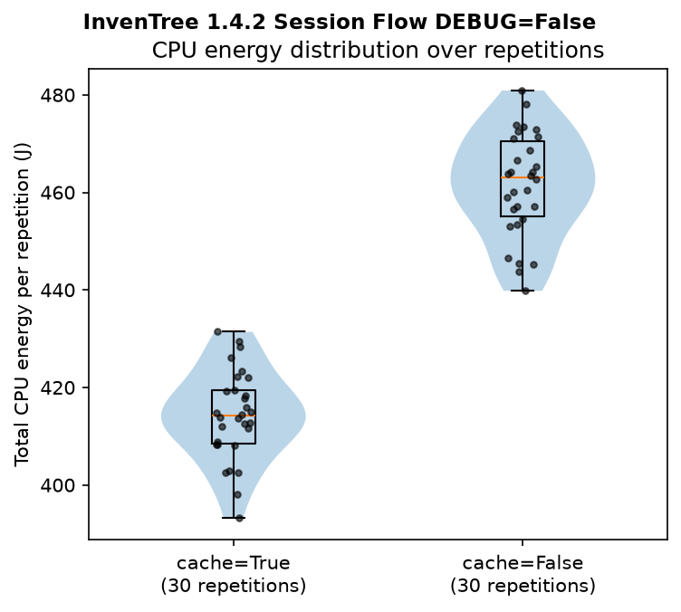
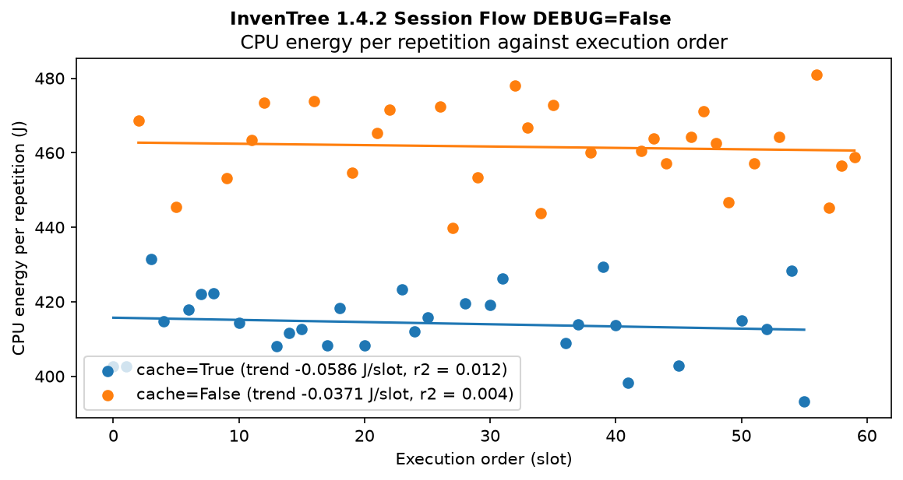
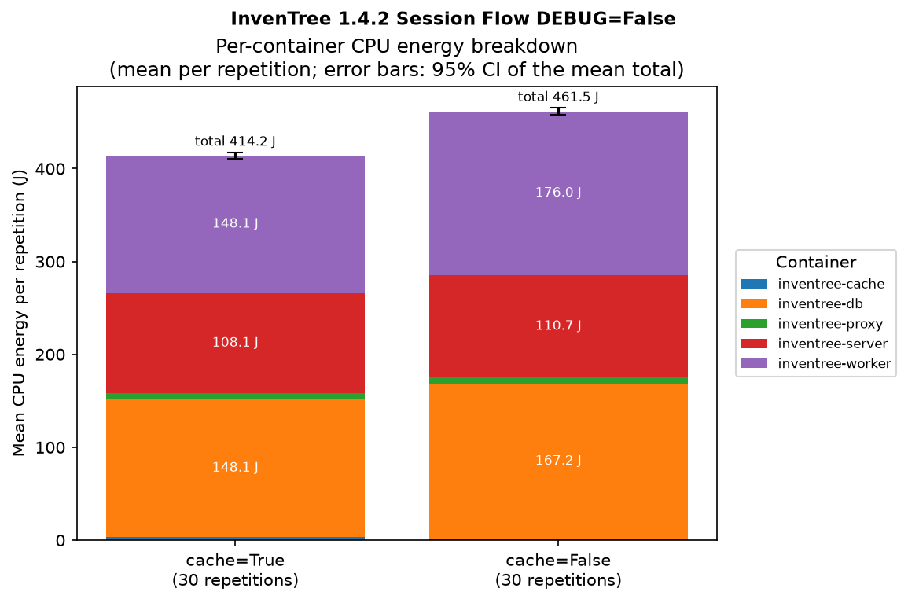
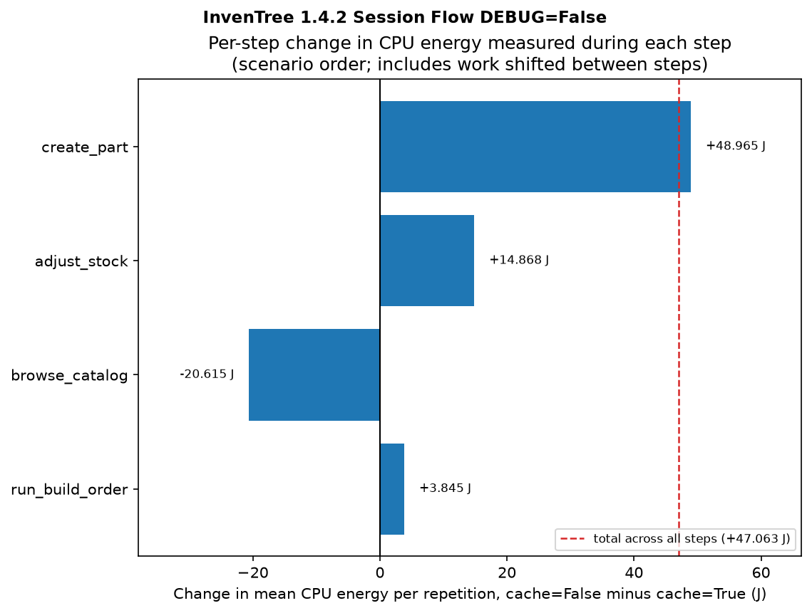

# Evaluation Results

---

The output of `metrilens report`, one directory per `comparison_session`, as it writes under
`evaluation/<host_descriptor>/<scenario_id>_<comparison_session_id>/` by default.

Kept here under `paper-evaluation/` as the paper's frozen, example dataset. Everything here is generated by
`evaluation.py` from archived measurement data (see `docs/guides/running-a-session.md` for how a session and its report are produced).

The sessions kept here are the actual results behind the accompanying paper, kept as the concrete record of what was measured.

## Overview of results

---

The repository's validation uses InvenTree with a known outcome: its default configuration
(`DEBUG=False`, `cache=True`) against variants expected to use more energy. Three sessions on one
bare-metal host, 30 repetitions per version each, all against the same baseline:

| Session | Compared version | Difference per repetition | Welch 95% CI | Relative (Fieller 95% CI) |
|---|---|---|---|---|
| `debug_only` | `DEBUG=True cache=True` | +8.9 J | [+3.5, +14.4] J | +2.2% [+0.8, +3.5] |
| `cache_only` | `DEBUG=False cache=False` | +47.3 J | [+42.1, +52.4] J | +11.4% [+10.1, +12.7] |
| `debug_and_cache` | `DEBUG=True cache=False` | +51.3 J | [+46.0, +56.6] J | +12.3% [+11.0, +13.7] |

MetriLens detects both expected effects: disabling the cache costs about 11%, debug mode about 2%,
on a baseline of about 414 J per repetition. The figures below are from the `cache_only` session:

  
  

  
  

## About the sessions

---

All three ran on host `measurement_host` against the `inventree_session_flow` scenario (internal scenario id `2`),
30 usable repetitions per version each, all against the same baseline: InvenTree 1.4.2, Session Flow,
`DEBUG=False cache=True`. The raw per-repetition archives are not published.

Each isolates a different factor of the same underlying comparison:

| Directory                            | `comparison_session` id | Compared version | What it isolates |
|---|---|---|---|
| `./measurement_host/debug_only`      | 8                       | `DEBUG=True cache=True`                   | The DEBUG factor alone |
| `./measurement_host/cache_only`      | 9                       | `DEBUG=False cache=False`                 | The cache factor alone |
| `./measurement_host/debug_and_cache` | 10                      | `DEBUG=True cache=False`                  | The joint effect of both factors |

The single-factor sessions (`debug_only`, `cache_only`) let each factor's own cost be read off directly. Each
session has its own baseline repetitions, so a difference between sessions mixes the factors with session-to-session
variation; the sessions are not designed to estimate an interaction between the two factors.
See `scenarios/inventree_session_flow/app_versions.yaml` for the exact version definitions this
scenario runs against. METRION was built from
[boehmtobias/Metrion](https://github.com/boehmtobias/Metrion) at commit
[`f9d12a9`](https://github.com/boehmtobias/Metrion/commit/f9d12a90e6167601a265f00fd3af881ca51fc2c5)
and ran with its default configuration.

## Configuration

---

These sessions ran with every operational setting at `config.example.yaml`'s stock default
(`max_retries: 3`, `readiness_timeout_s: 60`, `reset_timeout_s: 240`, `settle_time_s: 60`,
`monitor_tail_wait_s: 3.0`, `monitor_stop_timeout_s: 90.0`), none tuned for these runs, and
InvenTree's own unmodified example `readiness_auth` block. The remaining config keys are this
machine's install paths and carry no information relevant to verifying the results.

## Reading a session's output

---

Each directory holds:

- `comparison_report.md`: the human-readable report: setup, descriptive statistics, the comparison
  (difference with Welch and Fieller intervals, Mann-Whitney U as a robustness check, and a run-order-adjusted
  difference), per-container energy, and supplementary figures (active/idle, per-thread, per-step,
  per-iteration).
- `summary.json`: the same numbers from the report as structured data, for anything that needs to consume them
  programmatically.
- `fig*.png` / `fig*.pdf`: the figures the report embeds, each also available standalone.
