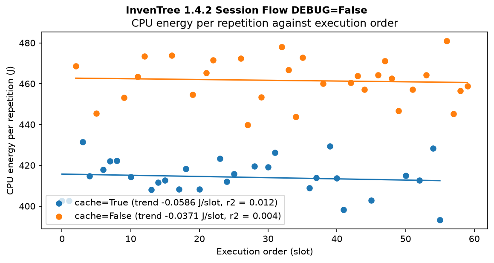
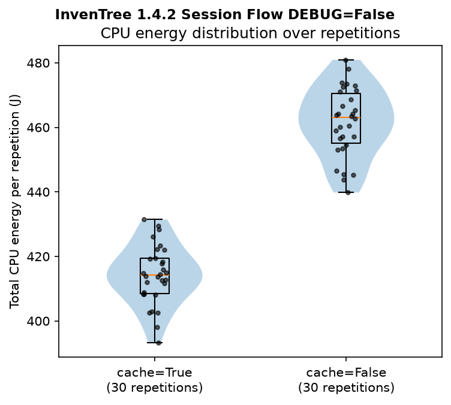
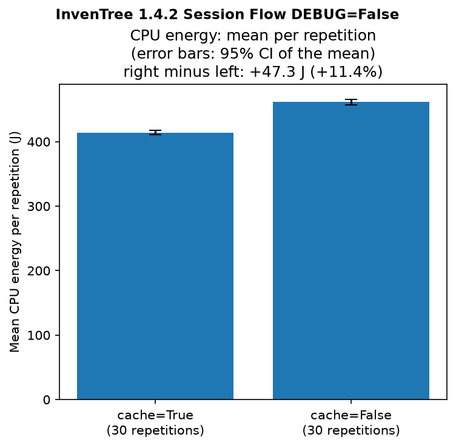
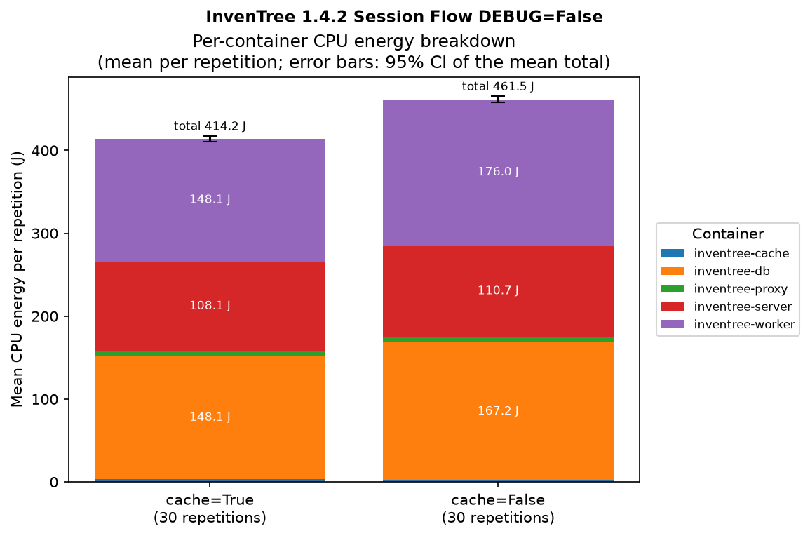
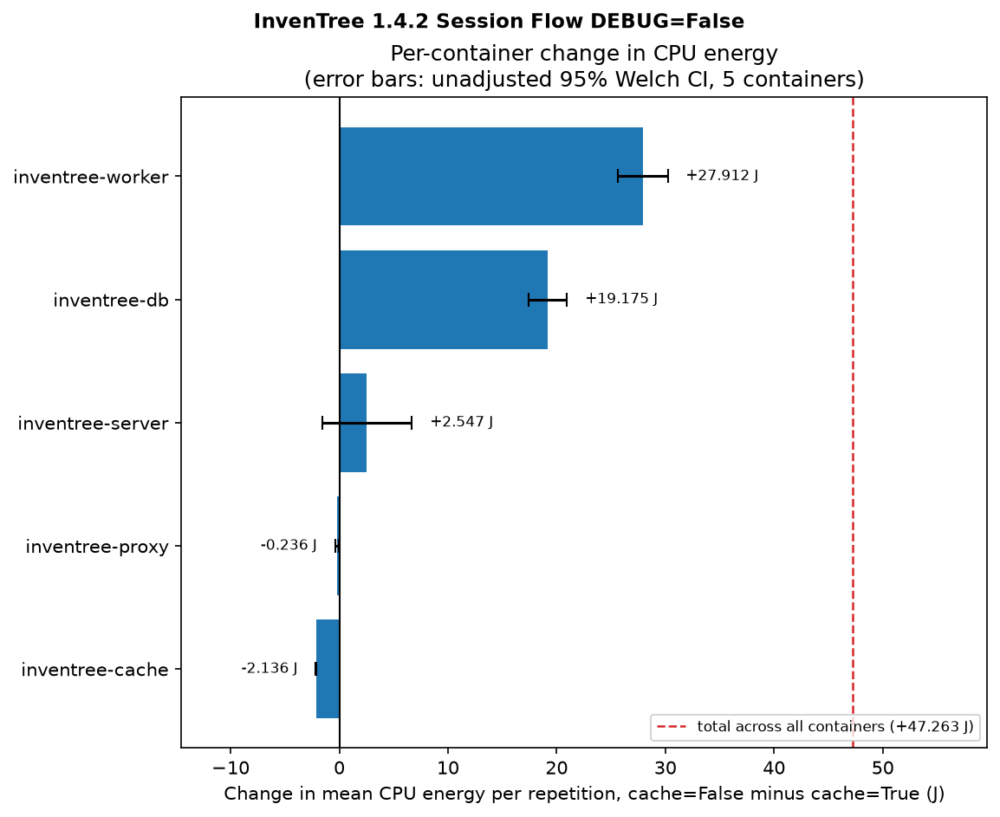
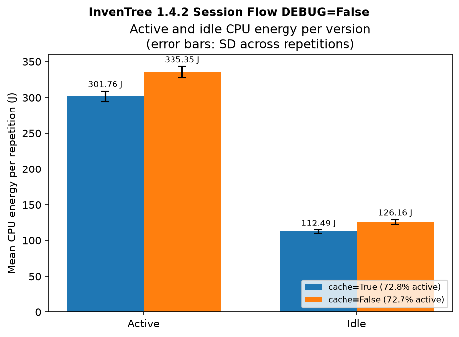
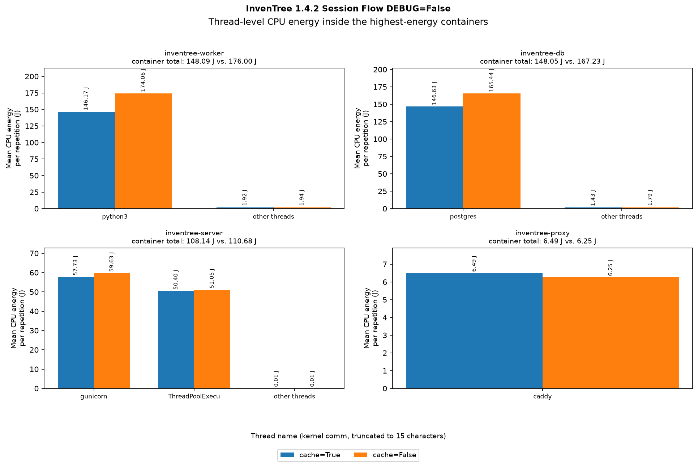
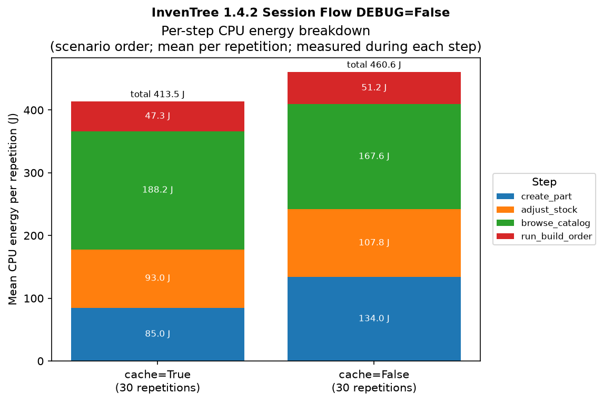
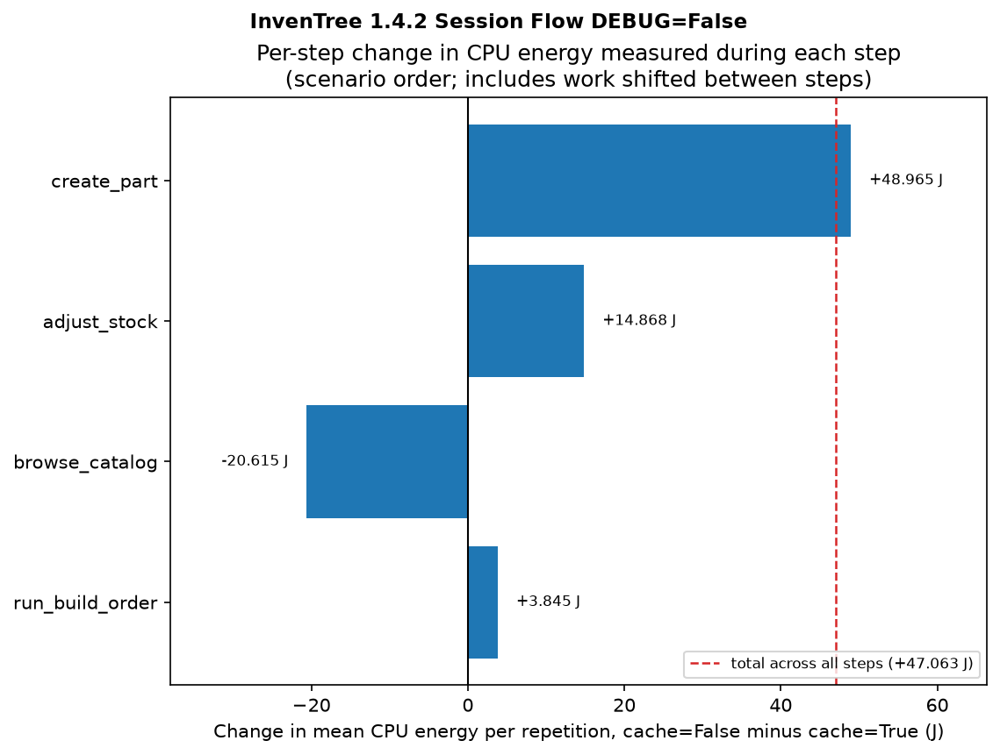
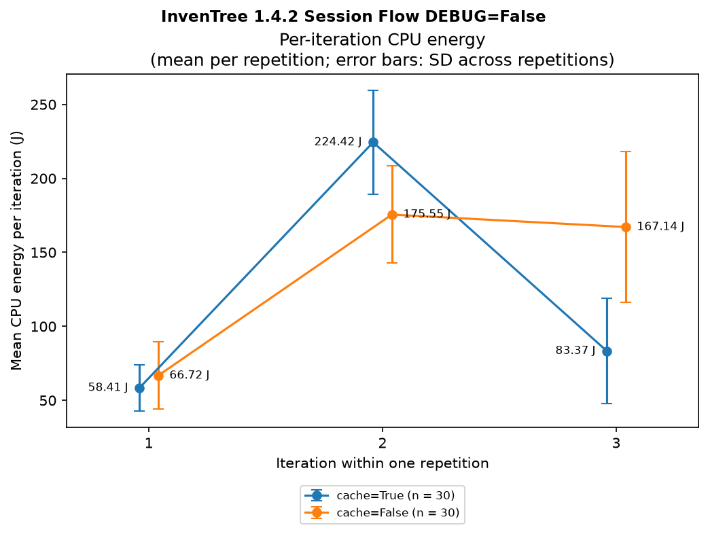

# Evaluation Report: scenario 2, comparison_session 9

Generated 2026-10-23T06:51:47.925663+00:00.

## 1. Setup

Version `a` is the baseline: every difference below is `b` minus `a`, following `run-session`'s argument order. Only repetitions that reached `ok` are included.

|  | Version | `app_version` | Scheduled | Usable | Retried | With notes |
|---|---|---|---|---|---|---|
| Baseline (`a`) | InvenTree 1.4.2 Session Flow DEBUG=False cache=True | 7 | 30 | 30 | 2 | 2 |
| Compared (`b`) | InvenTree 1.4.2 Session Flow DEBUG=False cache=False | 10 | 30 | 30 | 7 | 7 |

| Setting | Value |
|---|---|
| Host | `measurement_host` |
| METRION config | `/opt/metrion-runtime/config.yaml` |
| Measured host idle power | 17.153 W (`package_0`) |
| CPU governor | `performance` |
| Host hardware and OS | Intel(R) Core(TM) Ultra 9 285K, 24 cores, kernel 7.0.0-31-generic, Ubuntu 26.04.1 LTS (Resolute Raccoon), bare metal |
| METRION build | `metrion-0.1.0`, package `0a7b4649340749c0` |
| Random seed | `20260922` |
| Equivalence check | PASS |

Each repetition's energy covers its declared steps, from the first step's start to the last step's end, rounded outward to whole seconds; stack reset, readiness wait, browser launch and login are outside it. CPU energy is METRION's per-thread energy summed over the target stack's containers, including the idle share METRION attributes to them.

Execution order (randomized, read left to right):

```
run  1-10  a a b a a b a a a b
run 11-20  a b b a a a b a a b
run 21-30  a b b a a a b b a b
run 31-40  a a b b b b a a b a
run 41-50  a a b b b a b b b b
run 51-60  a b a b a a b b b b
```



## 2. Descriptive Statistics

| Metric | `a` InvenTree 1.4.2 Session Flow DEBUG=False cache=True | `b` InvenTree 1.4.2 Session Flow DEBUG=False cache=False |
|---|---|---|
| CPU energy n | 30 | 30 |
| CPU energy mean (J) | 414.25 | 461.51 |
| CPU energy SD (J) | 9.13 | 10.65 |
| CPU energy median (J) | 414.15 | 463.04 |
| CPU energy min (J) | 393.18 | 439.81 |
| CPU energy max (J) | 431.41 | 480.90 |
| Runtime mean ± SD (s) | 37.5 ± 0.7 | 37.9 ± 0.6 |



## 3. Comparison

|  | CPU energy |
|---|---|
| Difference `b` - `a` (J) | +47.26 |
| Welch 95% CI (J) | [+42.13, +52.39] |
| Relative difference | +11.41% |
| Fieller 95% CI | [+10.12, +12.72]% |
| Welch t (df) | 18.45 (56.7) |
| Welch p | < 0.001 |
| Mann-Whitney U p | < 0.001 |
| Run-order-adjusted difference (J) [95% CI] | +47.71 [+42.35, +53.06] |

Welch's t-test does not assume equal variances. The relative difference is `b` over `a` minus one, with a Fieller interval. Mann-Whitney U is a robustness check. The run-order adjustment is a least-squares fit of energy on version and execution slot.



## 4. Per-Container Energy

| Container | `a` mean (J) | `b` mean (J) | Difference (J) | Welch 95% CI (J) |
|---|---|---|---|---|
| `inventree-worker` | 148.09 | 176.00 | +27.91 | [+25.61, +30.21] |
| `inventree-db` | 148.05 | 167.23 | +19.18 | [+17.40, +20.95] |
| `inventree-server` | 108.14 | 110.68 | +2.55 | [-1.59, +6.69] |
| `inventree-proxy` | 6.49 | 6.25 | -0.24 | [-0.39, -0.08] |
| `inventree-cache` | 3.49 | 1.35 | -2.14 | [-2.17, -2.11] |

Mean CPU energy per repetition per container. The intervals are not adjusted for the number of containers.





## Supplementary Figures

Active and idle CPU energy per version; idle is METRION's time share of the measured idle power.



Thread-level CPU energy inside the highest-energy containers.



Mean CPU energy measured during each declared step, in scenario order.



Change in energy measured during each step; the background worker queue shifts work between steps, so these are not per-step effects.



Mean energy per iteration of the repeated step block, with SD whiskers; work also shifts between iterations.


